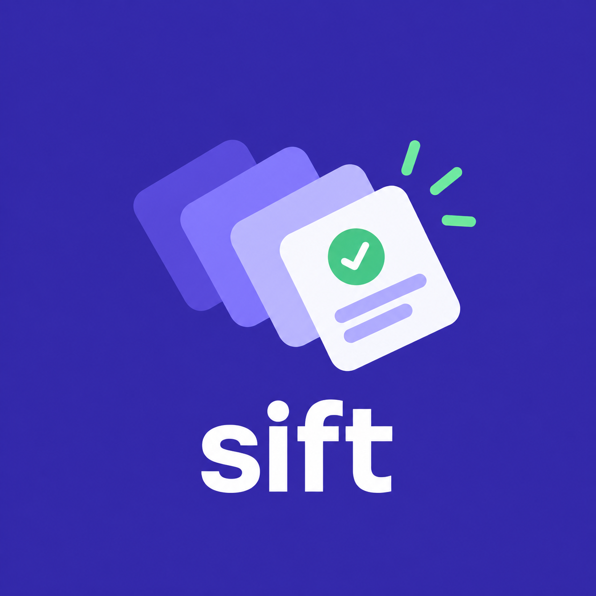

<p align="center"></p>

# sift

[](https://codecov.io/gh/tyrantkhan/sift)

An agent reviews a plan, a spec or code and hands you 30 findings in one scrolling list. sift shows them to you one at a time instead, most severe first. You decide each with one key, and your decisions go back to the agent, which applies them.

Inspired by [loupe](https://github.com/eriksaulnier/loupe), which does the same for GitHub pull request reviews.


## How it works

1. The agent starts a round on the files it reviewed (`sift start plan.md`, or `sift start --changed` for the code changed in git), files its findings with `sift add`, and runs `sift handoff`. That opens `sift review` in a pane beside the agent.
2. You see one card at a time. Each card shows the finding, the change the agent proposes, and the lines of the file it points at. After each decision, the next pending card opens.

   | Key | Decision |
   | :-- | :-- |
   | `a` | Approve. The agent makes its proposed change. |
   | `s` | Suggest. Approve with your tweak, which the agent applies. |
   | `x` / `X` | Reject / reject and say why. |
   | `d` | Discuss. Ask the agent; it answers, revises or withdraws, and you decide again. |
   | `u` | Undo, back to pending. |
   | `←` `→` `l` | Previous, next, list of all findings. |
   | `f` | Finish. Send your decisions, or see what is left and jump to it. |

3. After your last decision the finish screen opens. If a finding still waits on the agent's answer, it says so and updates when the answer arrives. Once everything is decided, add an optional note on the work as a whole and press enter to send. The send button stays dim for a moment after the screen opens, so a double-tapped enter from your last decision cannot send by accident. The pane closes, and the agent, blocked in `sift wait`, gets your decisions and applies them.

Every decision saves at once, so you can quit and come back with `sift review --run <id>`. `sift list` shows the ids; without `--run` it opens the latest run.

## Install the CLI

```sh
# Script: installs the latest release to ~/.local/bin after checking its checksum
curl -sSL https://tyrantkhan.github.io/sift/install.sh | sh

# Homebrew (macOS and Linux)
brew install --cask tyrantkhan/tap/sift

# mise
mise use -g github:tyrantkhan/sift

# Go
go install github.com/tyrantkhan/sift/cmd/sift@latest
```

Each [release](https://github.com/tyrantkhan/sift/releases) also has archives for macOS and Linux on amd64 and arm64, with a `checksums.txt`. macOS builds are signed and notarized.

## Teach your agent

sift works with any agent that can run shell commands. The workflow it follows is one skill, [`skills/sift/SKILL.md`](skills/sift/SKILL.md). The agent passes its own name with `sift start --agent`, and the review uses it ("Codex answered F3"). Without a name, the review says "the agent".

<details>
<summary>Claude Code</summary>

```sh
claude plugin marketplace add tyrantkhan/sift
claude plugin install sift@sift
```

The plugin also adds a `SessionStart` hook that tells Claude, in two lines, to hand review findings over with sift. Claude Code sometimes lists a plugin skill without its description, and the skill then never triggers; the hook does not depend on the listing. The same hook ships for Codex and Cursor.

</details>

<details>
<summary>Codex</summary>

```sh
codex plugin marketplace add tyrantkhan/sift
codex plugin add sift@sift
```

The plugin's `SessionStart` hook runs on Codex too, with the same two lines of context.

Inside the Codex sandbox, sift cannot write its data directory or reach the terminal host. Approve the skill's requests to run `sift` outside the sandbox.

</details>

<details>
<summary>Gemini CLI</summary>

```sh
gemini extensions install https://github.com/tyrantkhan/sift
```

</details>

<details>
<summary>Pi</summary>

```sh
pi install git:github.com/tyrantkhan/sift
```

</details>

<details>
<summary>Cursor, and other Agent Skills tools</summary>

Copy the skill into a directory your tool discovers skills from, such as `~/.cursor/skills/` or `~/.agents/skills/`:

```sh
git clone https://github.com/tyrantkhan/sift.git ~/.agents/skills/sift
```

Or point your agent at the skill from the instructions it already reads, such as `AGENTS.md`: "When you have review findings for me to decide, follow `<path to sift>/skills/sift/SKILL.md`."

</details>

Update the CLI whenever you update the skill, since a newer skill can use a flag an older CLI lacks. `sift --version` shows which CLI you have.

If your agent asks before each shell command, allow `sift` commands (in Claude Code, `Bash(sift:*)`).

`sift handoff` opens the pane in [Herdr](https://herdr.dev), tmux, Orca or iTerm2. Elsewhere it prints the `sift review` command for you to run in another terminal.

## Commands

`sift help` lists them; `sift help <command>` shows each one's input and JSON result.

| Run by | Command | What it does |
| :-- | :-- | :-- |
| agent | `start` | Snapshot files into a new review round: named files, or `--changed` for git changes |
| agent | `add` | File findings (JSON), anchored to a line range or a Markdown heading in one of the files |
| agent | `summary` | Set the summary you read before the first card |
| agent | `handoff` | Open the review in a pane beside the agent |
| agent | `wait` | Block until you send a finding back or publish |
| agent | `reply` | Answer, revise or withdraw a finding you sent back |
| agent | `feedback` | Print your decisions |
| anyone | `show`, `list` | Inspect runs |
| human | `review` | Decide each finding, then send |

Runs live in `$SIFT_HOME`, by default `~/.local/share/sift`, one directory per run. There is no daemon and no database.

## License

MIT. See [LICENSE](LICENSE).
